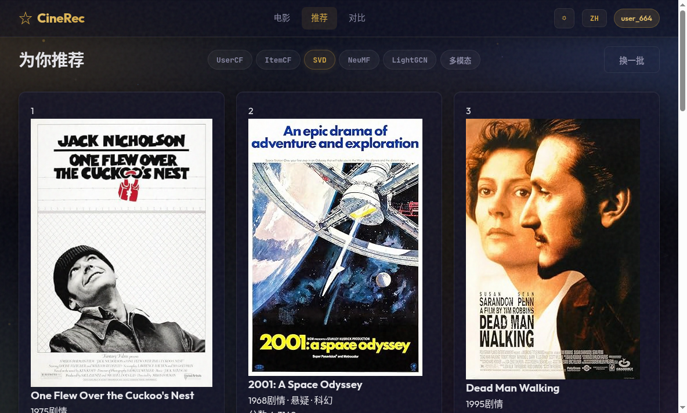
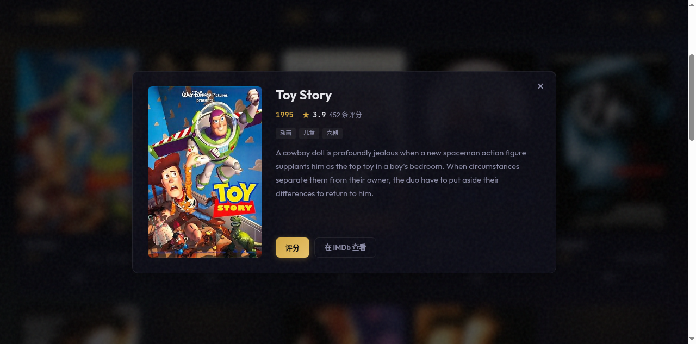
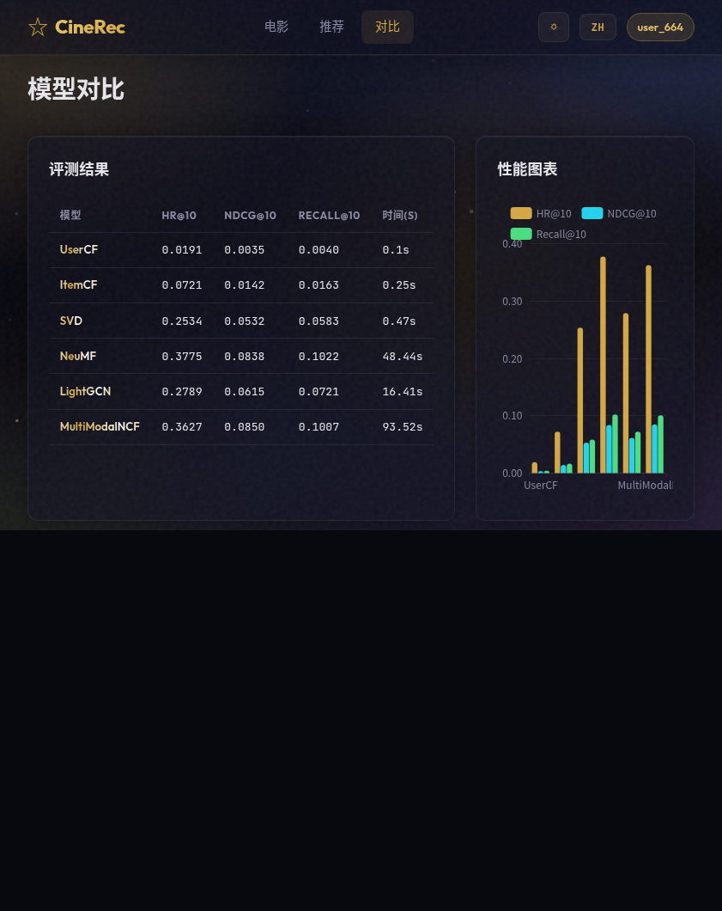
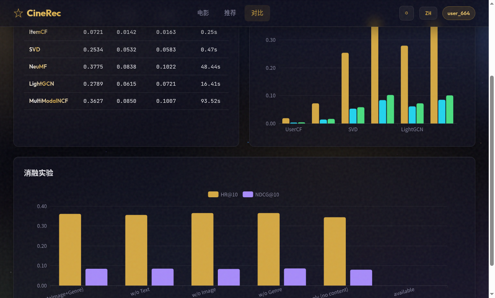
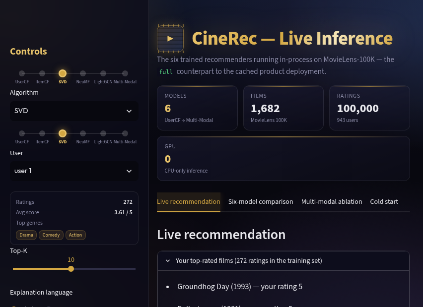
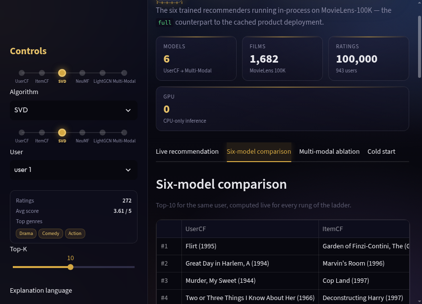
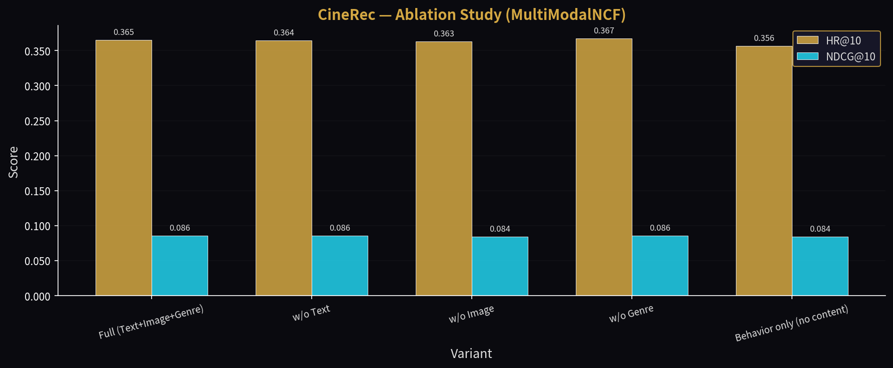
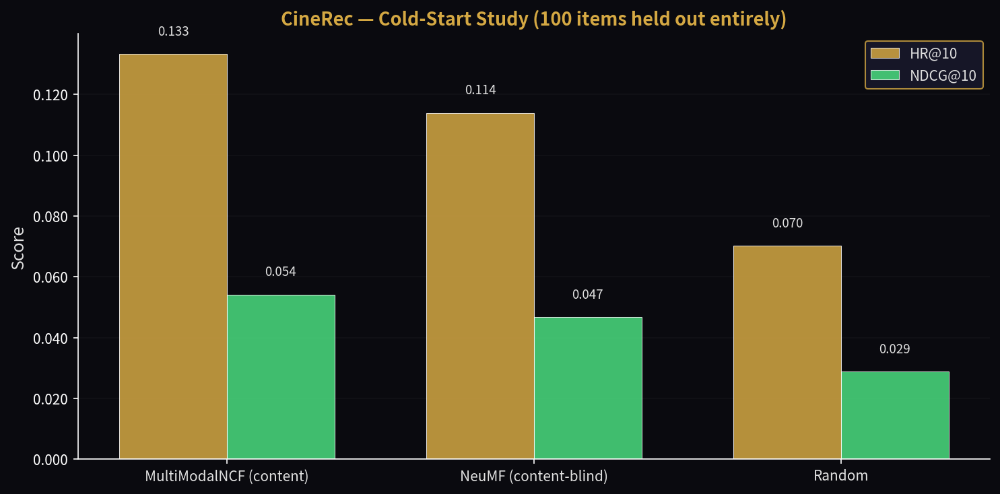
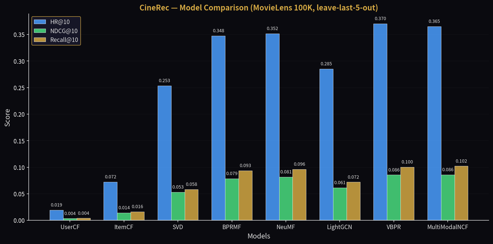
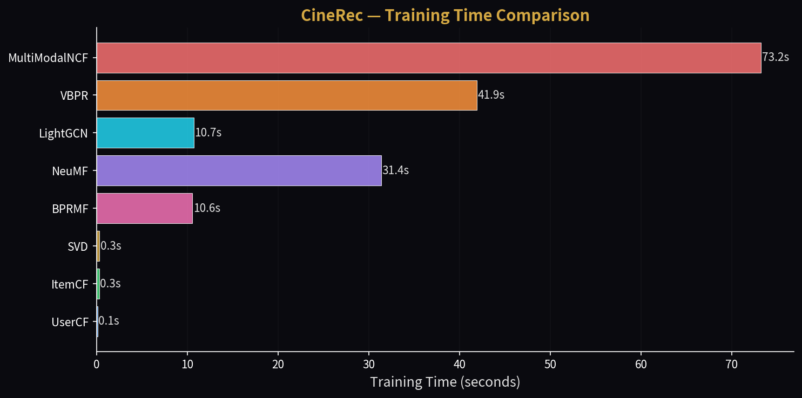

<div align="center">


<br><br>

# 🎬 CineRec

**Multi-Modal Movie Recommendation System**

*Six servable recommenders on one codebase — from UserCF to a multi-modal NCF — plus
two published SOTA baselines (BPR-MF, VBPR), all on a single leave-last-5-out split,
with the neural models reported as mean ± std over five seeds.*

[中文文档](#-项目简介) · [Live Demo](#-live-demo--在线演示) · [Demo](#-demo-preview--效果预览) · [Quick Start](#-quick-start--快速开始)

</div>

---

## 🔗 Live Demo / 在线演示

One codebase, two runtime modes (`APP_MODE`), each hosted on the free tier it fits
([ADR 0001](docs/adr/0001-dual-mode-deployment.md)):

| Mode | What it shows | Link |
|------|---------------|------|
| **`lite`** — product | The bilingual FastAPI web app. Recommendations come from a precomputed cache, so it fits a 512 MB instance. No account needed: click **游客体验 / Try as Guest**. | **https://cinerec-rfew.onrender.com** |
| **`full`** — companion | A Streamlit app that loads the trained PyTorch models and runs them **live**: live inference, the six-model comparison, the modality ablation, the cold-start study. | **https://cinerec-movie-recommend.streamlit.app** |

> Both run on free tiers and sleep when idle — the first visit can take a few
> seconds to wake. The companion lives in [`deploy/streamlit/`](deploy/streamlit/).

---

## 📋 Table of Contents

- [Live Demo / 在线演示](#-live-demo--在线演示)
- [Project Introduction / 项目简介](#-project-introduction--项目简介)
- [Key Features / 核心亮点](#-key-features--核心亮点)
- [Demo Preview / 效果预览](#-demo-preview--效果预览)
- [Architecture / 系统架构](#-architecture--系统架构)
- [Algorithms / 算法说明](#-algorithms--算法说明)
- [Evaluation / 评测结果](#-evaluation--评测结果)
- [Quick Start / 快速开始](#-quick-start--快速开始)
- [Tech Stack / 技术栈](#-tech-stack--技术栈)
- [Project Structure / 项目结构](#-project-structure--项目结构)
- [FAQ / 常见问题](#-faq--常见问题)
- [License](#-license)
- [Changelog / 更新日志](#-changelog--更新日志)

---

## 📖 Project Introduction / 项目简介

CineRec is a full-stack movie recommender that implements six models in ascending
order of complexity and scores all of them against the same candidate set. It ships
a bilingual dark-cinema web frontend, a REST API, and a Docker build that serves
either runtime mode from the same image.

CineRec 是一个全栈电影推荐系统，实现了 6 个复杂度递进的模型，并在同一候选集上统一
评测。它包含双语暗色 Web 前端、REST API，以及可用同一镜像服务两种运行模式的 Docker 构建。

> 💡 **"Don't just use models — understand them."**
> 不要只是用模型，要理解它们。CineRec 的每一层算法都展示了推荐系统从传统到前沿的演进路径。

---

## ✨ Key Features / 核心亮点

- **6 个模型，一个真相源** — UserCF → ItemCF → SVD → NeuMF → LightGCN → Multi-Modal NCF 全部登记在 [`models/registry.py`](models/registry.py)，前端、API 与预计算脚本都从这一处取。
- **多模态融合（核心创新）** — Multi-Modal NCF 在 MLP 路径上用 Content Tower 融合三路内容特征：Sentence-BERT 文本(384d)、ResNet-50 图像(2048d)、类型(18d)。
- **诚实的离线评测** — 单一 leave-last-5-out 划分，候选集剔除训练已见条目，所有模型共用同一套 HR@K / NDCG@K / Recall@K；神经模型固定随机种子，主评测、消融与冷启动均以 5 个种子的均值±标准差报告，并对照 BPR-MF / VBPR 两个公开 SOTA 基线，不作"最优模型"声明；同一协议在 Amazon Video_Games 第二数据集上完整复验。
- **可解释 · 双语 · 双模式** — 每条推荐给出理由；EN/ZH 前端；`lite`（预计算缓存）与 `full`（实时推理）由 `APP_MODE` 切换。
- **可观测** — 推理 LRU 缓存、`/api/metrics` 进程内延迟/吞吐，外加一次实测 Locust 压测 → [`reports/loadtest.md`](reports/loadtest.md)。
- 电影详情弹窗：点击任意卡片（或键盘 Enter）打开无障碍弹窗，含海报、简介、类型、平均评分、评分入口与 IMDb 链接；Escape、关闭按钮或遮罩点击均可关闭，随语言切换重绘。
- Streamlit 伴生应用：胶片 logo、KPI 条、融合推荐卡、纯 CSS 柱状图/热力图、算法阶梯与用户画像。

---

## 🖼 Demo Preview / 效果预览

### Recommendation Engine / 推荐引擎
> Real-time personalized recommendations with algorithm switching and explainable reasons.



### Movie Library / 电影库
> Browse 1,682 movies with real posters, search, genre filtering, and pagination. Click any card to open a detail popup with synopsis, rating, and IMDb link.


### Movie Detail Modal / 电影详情弹窗
> Click any movie card (or press Enter on a focused card) to open an accessible detail popup — poster, synopsis, genres, average rating, and actions to rate or view on IMDb. Closes with Escape, close button, or backdrop click; re-renders on language switch.



### Evaluation Dashboard / 评测看板
> Interactive model comparison with real leave-last-5-out evaluation metrics — all six models side by side.



### Ablation Charts / 消融实验图表
> A scrolled view of the evaluation page: the ablation study (one modality blanked at a time). Rendered from the committed JSON results — no hard-coded numbers.



> Cold-start is covered separately with its own measured chart in the **Measured Results** section below.

### Streamlit Companion (Full Mode) / Streamlit 伴生应用
> Live inference companion with a film-strip logo, KPI strip, CSS bar charts, a Jaccard overlap heatmap, an algorithm ladder, and a user profile mini-card.

<table>
<tr>
<td></td>
<td></td>
</tr>
<tr>
<td align="center"><sub>Live recommendation + KPI strip</sub></td>
<td align="center"><sub>Six-model comparison + heatmap</sub></td>
</tr>
</table>

---

## 🏗 Architecture / 系统架构

```
┌───────────────────────────────────────────────────────────────┐
│                        User Browser                          │
│     Dark/Light Theme · GSAP Animations · ECharts · i18n       │
├───────────────────────────────────────────────────────────────┤
│                     FastAPI REST API                          │
│                                                              │
│   /api/auth ───── /api/movies ───── /api/recommend           │
│        │              │                  │                   │
│        │              │         ┌────────┴────────┐           │
│        │              │         │  Algorithm Switch │           │
│        │              │         └────────┬────────┘           │
├────────┼──────────────┼──────────────────┼───────────────────┤
│        │       ┌──────┴──────┐    ┌───────┴───────┐          │
│  Auth Service   Movie Service  Recommend Service            │
│  (demo login)   (CRUD + posters) (6 Models + Explainer)       │
│        │              │                  │                   │
├────────┼──────────────┼──────────────────┼───────────────────┤
│        │       ┌──────┴──────────────────┴───────┐           │
│        │       │      Model Layer (6 Models)      │           │
│        │       │                                   │           │
│        │       │  ┌─────────┐  ┌─────────┐        │           │
│        │       │  │  UserCF  │  │  ItemCF  │        │           │
│        │       │  │ (Pearson)│  │(Adj Cos)│        │           │
│        │       │  └─────────┘  └─────────┘        │           │
│        │       │  ┌─────────┐  ┌─────────┐        │           │
│        │       │  │   SVD    │  │  NeuMF   │        │           │
│        │       │  │(SVD,k=64)│  │(GMF+MLP) │        │           │
│        │       │  └─────────┘  └─────────┘        │           │
│        │       │  ┌───────────────────────┐      │           │
│        │       │  │       LightGCN         │      │           │
│        │       │  │  Graph Convolution (BPR)│      │           │
│        │       │  └───────────────────────┘      │           │
│        │       │  ┌───────────────────────┐      │           │
│        │       │  │   Multi-Modal NCF ⭐   │      │           │
│        │       │  │ Text+Image+Genre Fusion│      │           │
│        │       │  └───────────────────────┘      │           │
│        │       └──────────────────────────────────┘           │
├────────┼─────────────────────────────────────────────────────┤
│        │       Feature Engineering (Pre-computed)            │
│  ┌─────┴─────┐  ┌──────────────┐  ┌──────────────┐        │
│  │Sentence-BERT│  │  ResNet-50   │  │Genre Encoding│        │
│  │  Text 384d │  │  Image 2048d │  │  Multi-hot   │        │
│  └───────────┘  └──────────────┘  └──────────────┘        │
├─────────────────────────────────────────────────────────────┤
│               Data Layer (SQLite + MovieLens 100K)          │
│  100,000 ratings · 943 users · 1,682 movies · enriched metadata │
└─────────────────────────────────────────────────────────────┘
```

---

## 🧮 Algorithms / 算法说明

| Level | Model | Method | Description |
|:-----:|-------|--------|-------------|
| 1 | **UserCF** | Pearson Correlation | Find K similar users, aggregate their preferences. Vectorized computation. |
| 2 | **ItemCF** | Adjusted Cosine | Recommend items similar to user's rated history. Vectorized similarity. |
| 3 | **SVD** | Matrix Factorization | Decompose the user-item matrix into latent factors (k=64) via truncated SVD (`scipy.sparse.linalg.svds`). |
| 4 | **NeuMF** | GMF + MLP (PyTorch) | Dual-path architecture: element-wise product + deep MLP. BCE loss with negative sampling. |
| 5 | **LightGCN** | Graph Convolution (PyTorch) | Simplified GCN on the user–item bipartite graph: neighbourhood aggregation averaged over layers, trained with BPR. |
| 6 | **Multi-Modal NCF** ⭐ | Text+Image+Genre Fusion | Core innovation. Replaces item embedding in MLP path with a Content Tower fusing multi-modal features. |

> **Offline SOTA baselines** — BPR-MF and VBPR are implemented
> ([`models/bpr_mf.py`](models/bpr_mf.py) / [`models/vbpr.py`](models/vbpr.py)) purely
> for the evaluation comparison; they are **not** part of this servable ladder and
> never ship to the API.

### Multi-Modal NCF Architecture (Core Innovation / 核心创新)

```
                    ┌──────────────────┐
                    │   User Tower     │
                    │ user_id → Emb(64)│
                    └────────┬─────────┘
                             │
              ┌──────────────┼──────────────┐
              ▼              ▼              ▼
     ┌────────────┐  ┌──────────────┐
     │  GMF Path  │  │  MLP Path    │
     │ user⊙item  │  │              │
     │ (behavior) │  │  Content Tower (⭐)
     └─────┬──────┘  │  ┌────────────────────┐
           │         │  │ Text(384)→FC(64)    │
           │         │  │ Image(2048)→FC(64)   │
           │         │  │ Genre(18)→FC(64)    │
           │         │  │ Concat(192)→FC(64)  │
           │         │  └──────────┬─────────┘
           │         │             │
           │         │  Concat(user, content)
           │         │      FC(128→256→128→64)
           │         └──────┬──────┘
           │                │
           └─────── Concat(GMF, MLP) ──→ FC(128→1) ──→ Sigmoid ──→ Prediction
```

**Cold Start Support**: New items use `content_emb` only, GMF path uses zero vector.

---

## 📊 Evaluation / 评测结果

> **Scope / 定位说明** — CineRec is a full-stack engineering and trade-off study, not
> a leaderboard entry. All models share one fixed split; neural numbers are reported
> as **mean ± std over seeds**, so every claim is read against the measured noise.
> The whole protocol is re-run unchanged on a second domain (Amazon Video_Games)
> to check which conclusions travel. CineRec 是一个工程与取舍研究项目，不是刷榜：
> 所有模型共用同一划分，神经结果以多种子均值±标准差报告，结论的强弱以实测噪声为界；
> 同一协议在第二个域（Amazon Video_Games）上原样重跑，以检验哪些结论能跨域成立。

### Research Questions / 研究问题

| # | Question / 问题 | Answered by |
|:--|:----------------|:------------|
| **RQ1** | 相比纯行为信号，内容特征（文本/图像/类型）在同一排序任务上带来多大提升？ | [Ablation](#ablation-study--消融实验) |
| **RQ2** | 这一提升是否大于随机种子的波动？ | 主表与消融表的 **mean ± std** |
| **RQ3** | 内容特征能否迁移到完全没有交互历史的冷启动条目？ | [Cold-start](#cold-start-study--冷启动实验) |
| **RQ4** | 与已发表的 SOTA 基线（BPR-MF / VBPR）相比处于什么位置？ | [Baseline comparison](#sota-baselines--sota-基线对比) |
| **RQ5** | 上述结论是否是 MovieLens 特有的？换一个域还成立吗？ | [Cross-dataset](#cross-dataset-validation--跨数据集验证) |

### Contributions / 主要贡献

1. **一个可复现的统一评测协议** —— 单一 leave-last-5-out 划分、跨模型对齐的候选集
   （剔除用户训练已见条目）、以及覆盖随机种子全链路的多种子评测，主结果以 5 个种子的
   均值±标准差报告（`make eval-seeds`）。
2. **Multi-Modal NCF（核心创新）** —— 在 NCF 的 MLP 路径上用 Content Tower 融合
   Sentence-BERT 文本、ResNet-50 图像与类型多热三路特征。
3. **诚实的消融与冷启动研究** —— 两者都以多种子报告，明确区分"真实效应"与"种子噪声"。
4. **与公开 SOTA 基线对照** —— 在同一划分上复现 BPR-MF（Rendle 2009）与
   VBPR（He & McAuley 2016），作为行为-only 与内容感知两条线的外部参考。
5. **跨数据集验证** —— 同一协议与种子列表在第二个域（Amazon Video_Games，
   2,288 重度用户 × 4,753 物品）上完整重跑主评测/消融/冷启动，检验结论是否
   随域迁移（[ADR 0005](docs/adr/0005-cross-dataset-validation.md)）。

### Model Comparison on MovieLens 100K (leave-last-5-out)

Protocol: the 5 most recent interactions of each user are held out; every model is
scored against the same candidate set (all items minus the user's training items),
so re-recommending already-seen titles cannot inflate the numbers. Numbers are
**mean ± std over 5 random seeds (42–46)**, reproduced with `make eval-seeds`
(writes `data/processed/eval_multiseed.json`). The Train Time column is the same
5-seed mean from that file; a single-seed run's wall-clock lives in
`eval_results.json` (the server-side artefact). The three heuristics/MF models are
deterministic, so their spread is exactly zero.

| Model | HR@10 | NDCG@10 | HR@20 | NDCG@20 | Train Time |
|:-----:|:-----:|:-------:|:-----:|:-------:|:-----------:|
| UserCF | 0.0191 ± 0.0000 | 0.0035 ± 0.0000 | 0.0477 ± 0.0000 | 0.0060 ± 0.0000 | 0.1s |
| ItemCF | 0.0721 ± 0.0000 | 0.0142 ± 0.0000 | 0.1283 ± 0.0000 | 0.0199 ± 0.0000 | 0.3s |
| SVD | 0.2534 ± 0.0000 | 0.0532 ± 0.0000 | 0.3542 ± 0.0000 | 0.0664 ± 0.0000 | 0.3s |
| NeuMF | 0.3516 ± 0.0036 | 0.0814 ± 0.0016 | 0.4978 ± 0.0073 | 0.1083 ± 0.0017 | 31.4s |
| LightGCN | 0.2850 ± 0.0041 | 0.0614 ± 0.0004 | 0.4250 ± 0.0047 | 0.0816 ± 0.0007 | 10.7s |
| **MultiModalNCF** ⭐ | **0.3650 ± 0.0077** | **0.0859 ± 0.0017** | **0.5073 ± 0.0148** | **0.1144 ± 0.0015** | 73.2s |

> **What the numbers say (six ladder models)**: averaged over 5 seeds,
> **MultiModalNCF** leads all four shown metrics *within the ladder* — HR@10 0.3650 /
> NDCG@10 0.0859 / HR@20 0.5073 / NDCG@20 0.1144 — and **NeuMF** is the runner-up
> (0.3516 / 0.0814). Within the ladder the HR@10 gap (0.0134) is larger than either
> model's seed spread, while the HR@20 gap (0.0095) sits inside the MultiModalNCF std
> (0.0148). **LightGCN** lands between SVD and NeuMF at a fraction of NeuMF's
> training time. The neural models pay for their gains with a much longer training
> time, making the accuracy/cost trade-off explicit — and once the *published*
> baselines join the comparison, the top margins close further (next section), so no
> strong "best model" significance claim is made.

### Key Findings / 关键发现

- UserCF → ItemCF → SVD keeps the expected ordering — neighbourhood heuristics give
  way to matrix factorization — and SVD is the strongest accuracy-per-second point on
  the ladder (HR@10 0.2534, and deterministic, so seed-free).
- NeuMF: HR@10 0.3516 ± 0.0036 / HR@20 0.4978 ± 0.0073. Non-linear interaction
  modelling edges out plain factorization once candidates are filtered to unseen
  items, with a small but non-zero seed spread.
- LightGCN: HR@10 0.2850 ± 0.0041, between SVD and NeuMF, and the best accuracy per
  second among the neural models — competitive with no content features at all.
- MultiModalNCF: HR@10 0.3650 ± 0.0077 / NDCG@10 0.0859 ± 0.0017. Averaged over 5
  seeds it leads both the hit-rate and NDCG columns among the six ladder models, and
  the ablation study below quantifies each modality's share.

### SOTA Baselines / SOTA 基线对比

To place CineRec against the literature rather than only against itself, the same
split is used to reproduce two published baselines — **BPR-MF** (Rendle et al.,
UAI 2009) as the behaviour-only reference, and **VBPR** (He & McAuley, AAAI 2016)
as the content-aware one. They are offline references only: they are not part of
the servable ladder ([`models/registry.py`](models/registry.py)) and never ship to
the API.

| Model | Line | HR@10 | NDCG@10 | HR@20 | NDCG@20 | Train Time |
|:------|:-----|:-----:|:-------:|:-----:|:-------:|:----------:|
| BPR-MF (Rendle 2009) | behaviour-only | 0.3476 ± 0.0116 | 0.0785 ± 0.0018 | 0.4831 ± 0.0116 | 0.1034 ± 0.0018 | 10.6s |
| NeuMF (ours) | behaviour-only | 0.3516 ± 0.0036 | 0.0814 ± 0.0016 | 0.4978 ± 0.0073 | 0.1083 ± 0.0017 | 31.4s |
| VBPR (He & McAuley 2016) | content-aware | 0.3705 ± 0.0048 | 0.0855 ± 0.0009 | 0.5200 ± 0.0096 | 0.1130 ± 0.0008 | 41.9s |
| **MultiModalNCF** (ours) ⭐ | content-aware | 0.3650 ± 0.0077 | **0.0859 ± 0.0017** | 0.5073 ± 0.0148 | **0.1144 ± 0.0015** | 73.2s |

> **Reading the baseline comparison (RQ4)**: adding content helps *within each pair* —
> VBPR > BPR-MF and MultiModalNCF > NeuMF. Against the *published* content-aware
> baseline, MultiModalNCF is statistically tied: VBPR edges HR@10 (0.3705 vs 0.3650)
> and HR@20 (0.5200 vs 0.5073) by less than one seed std, while MultiModalNCF leads
> both NDCG columns (0.0859 / 0.1144 vs 0.0855 / 0.1130). Reaching the published
> baseline's level on its own terms — with a text+image+genre tower rather than a
> single visual term — is the honest reading; the differences are too small to claim
> an outright win. One caveat on the budget: MultiModalNCF runs only **10** epochs
> against VBPR's 30 and BPR-MF's 50, so the baseline numbers come from a longer
> schedule (though MultiModalNCF still costs the most wall-clock time, 73.2s vs
> 41.9s, because of its larger content tower).

### Ablation Study / 消融实验

Each row retrains MultiModalNCF on the same split with one content modality blanked
at the input, isolating its contribution. **Every row is now mean ± std over 5 seeds
(42–46)** (`make ablation-seeds`), so each delta can be read against the seed noise
measured on the Full variant.

| Variant | HR@10 | NDCG@10 | HR@20 | NDCG@20 |
|:--------|:-----:|:-------:|:-----:|:-------:|
| Full (Text+Image+Genre) | 0.3650 ± 0.0077 | 0.0859 ± 0.0017 | 0.5073 ± 0.0148 | 0.1144 ± 0.0015 |
| w/o Text | 0.3642 ± 0.0100 | 0.0855 ± 0.0024 | 0.5075 ± 0.0108 | 0.1144 ± 0.0025 |
| w/o Image | 0.3631 ± 0.0085 | 0.0842 ± 0.0026 | 0.5080 ± 0.0029 | 0.1132 ± 0.0025 |
| w/o Genre | 0.3673 ± 0.0080 | 0.0857 ± 0.0015 | 0.5107 ± 0.0139 | 0.1144 ± 0.0016 |
| **Behavior only (no content)** | 0.3565 ± 0.0061 | 0.0844 ± 0.0024 | 0.4931 ± 0.0089 | 0.1123 ± 0.0033 |

> **Reading the ablation (RQ1/RQ2)**: dropping *all* content features (behavior only)
> lowers **every** metric — HR@10 0.3650→0.3565, NDCG@10 0.0859→0.0844, HR@20
> 0.5073→0.4931, NDCG@20 0.1144→0.1123 — so content has a consistent, same-signed
> effect. Its magnitude, though, is about one seed std (Full HR@10 std 0.0077 vs the
> 0.0085 drop), so it is a **small** effect, not a decisive one. The single-modality
> deltas sit inside the noise and one even flips sign (w/o Genre edges the Full
> HR@10), so **no per-modality ranking is claimed** — at this scale the three
> modalities are close to interchangeable.



### Cold-Start Study / 冷启动实验

100 items are removed from training entirely, then ranked within the cold pool
(the content-aware task). MultiModalNCF scores them through the content tower —
no trained embedding — while NeuMF is the content-blind control. **Reported as
mean ± std over 5 seeds** (`make coldstart-seeds`).

| Model | HR@10 | NDCG@10 | HR@20 | NDCG@20 |
|:------|:-----:|:-------:|:-----:|:-------:|
| **MultiModalNCF (content)** ⭐ | **0.1333 ± 0.0290** | **0.0542 ± 0.0151** | **0.2754 ± 0.0233** | **0.0882 ± 0.0139** |
| NeuMF (content-blind) | 0.1140 ± 0.0147 | 0.0467 ± 0.0069 | 0.2351 ± 0.0129 | 0.0739 ± 0.0038 |
| Random | 0.0702 | 0.0288 | 0.2018 | 0.0610 |

> **Reading the cold-start study (RQ3)**: the ordering is identical on every metric —
> content-aware > content-blind > random (e.g. HR@10 0.1333 > 0.1140 > 0.0702). The
> multi-modal tower therefore transfers to items with *no* collaborative history,
> which a behaviour-only model structurally cannot do (its cold embeddings are never
> trained). The content-aware margin over NeuMF is consistent in sign but its HR@10
> seed spread is wide (std 0.0290 vs the 0.0193 gap), so it is reported as a
> direction, not a precise magnitude.



### Cross-dataset Validation / 跨数据集验证

The whole protocol — same leave-last-5-out split rule, same candidate filtering,
same eight models, same positive-feedback threshold (≥ 4.0), same seed list
(42–46) — is re-run unchanged on **Amazon Reviews-2023 Video_Games**
([ADR 0005](docs/adr/0005-cross-dataset-validation.md)): a heavy-user slice of
2,288 users × 4,753 items × 75,980 ratings, built by applying *MovieLens 100K's
own population rule* (users with ≥ 20 ratings, item 5-core) to a different
domain. The candidate catalogue is ~2.8× larger than ML-100K's, which
mechanically depresses absolute HR@K — so the comparison reads **relative
orderings and delta directions**, not absolute values.

| Model | ML-100K HR@10 | Amazon HR@10 | ML-100K NDCG@10 | Amazon NDCG@10 |
|:------|:-------------:|:------------:|:---------------:|:--------------:|
| UserCF | 0.0191 ± 0.0000 | 0.0122 ± 0.0000 | 0.0035 ± 0.0000 | 0.0017 ± 0.0000 |
| ItemCF | 0.0721 ± 0.0000 | 0.0214 ± 0.0000 | 0.0142 ± 0.0000 | 0.0035 ± 0.0000 |
| SVD | 0.2534 ± 0.0000 | 0.0651 ± 0.0000 | 0.0532 ± 0.0000 | 0.0116 ± 0.0000 |
| BPR-MF (Rendle 2009) | 0.3476 ± 0.0116 | 0.1055 ± 0.0053 | 0.0785 ± 0.0018 | 0.0198 ± 0.0012 |
| NeuMF | 0.3516 ± 0.0036 | 0.1053 ± 0.0043 | 0.0814 ± 0.0016 | 0.0190 ± 0.0009 |
| LightGCN | 0.2850 ± 0.0041 | **0.1187 ± 0.0074** | 0.0614 ± 0.0004 | **0.0222 ± 0.0011** |
| VBPR (He & McAuley 2016) | **0.3705 ± 0.0048** | 0.1097 ± 0.0050 | 0.0855 ± 0.0009 | 0.0196 ± 0.0017 |
| **MultiModalNCF** ⭐ | 0.3650 ± 0.0077 | 0.1164 ± 0.0085 | **0.0859 ± 0.0017** | 0.0213 ± 0.0018 |

**Ablation on the second domain (HR@10, mean ± std over 5 seeds)**:

| Variant | ML-100K | Amazon |
|:--------|:-------:|:------:|
| Full (Text+Image+Genre) | 0.3650 ± 0.0077 | 0.1164 ± 0.0085 |
| w/o Text | 0.3642 ± 0.0100 | 0.1159 ± 0.0050 |
| w/o Image | 0.3631 ± 0.0085 | 0.1177 ± 0.0033 |
| w/o Genre | 0.3673 ± 0.0080 | 0.1194 ± 0.0017 |
| Behavior only (no content) | 0.3565 ± 0.0061 | 0.1163 ± 0.0011 |

**Cold-start on the second domain (HR@10)**:

| Model | ML-100K | Amazon |
|:------|:-------:|:------:|
| **MultiModalNCF (content)** ⭐ | 0.1333 ± 0.0290 | **0.2364 ± 0.0202** |
| NeuMF (content-blind) | 0.1140 ± 0.0147 | 0.1204 ± 0.0120 |
| Random | 0.0702 | 0.1092 |
| *content / blind ratio* | *1.17×* | *1.96×* |

> **Reading RQ5 — what travels and what doesn't**:
>
> **Transfers (agreement strengthens the MovieLens conclusions):**
> - The ladder ordering **UserCF < ItemCF < SVD** holds in both domains, and the
>   neural models' lead over SVD is *larger* on Amazon (0.105–0.119 vs 0.065).
> - **BPR-MF ≈ NeuMF**: the behaviour-only pair stays a statistical tie in both
>   domains, so the RQ4 reading is not a MovieLens artefact.
> - The ablation's single-modality deltas stay **inside seed noise** in both
>   domains (no per-modality ranking claimed anywhere).
> - **Cold-start is the strongest transfer of all — and it amplifies**: the
>   content tower's edge over the content-blind control grows from **1.17×**
>   on ML-100K to **1.96×** on Amazon (0.2364 vs 0.1204 HR@10, gap ≈ 5.6× the
>   combined std). The sparser the collaborative signal, the more the content
>   tower is worth — exactly what the modality story predicts.
>
> **Does not transfer (reported, not hidden):**
> - *"MultiModalNCF is the best model in the ladder."* On Amazon, **LightGCN**
>   takes the top HR@10 point estimate (0.1187 vs 0.1164) — a difference of
>   0.0023 against a combined seed spread of ~0.011, i.e. a statistical tie
>   that LightGCN wins at **1/7 of the training cost** (11.2s vs 77.4s). The
>   honest cross-domain conclusion: the neural band (0.105–0.119) is the same
>   in both domains, and the preferred model within it is domain-dependent.
> - *"Removing all content hurts."* On Amazon, Behavior only ≈ Full
>   (0.1163 vs 0.1164): with sparser implicit feedback, the NCF path re-learns
>   whatever the content tower added within the 10-epoch budget. On ML-100K
>   that drop was itself only ~1 seed std — the ablation already called it a
>   *small* effect, and on the second domain it vanishes entirely.

---

### Charts from Measured Results / 实测图表




---

## 🚀 Quick Start / 快速开始

> **Zero-training start**: the trained models, content features and a MovieLens
> seed ship in the repo (see [ADR 0002](docs/adr/0002-artifact-storage.md)), and the
> database is seeded on first boot — so a fresh clone serves real recommendations
> without downloading or training anything.

### Docker (Recommended / 推荐)

```bash
git clone https://github.com/ElijahZhao/cinerec.git
cd cinerec
docker compose up --build        # APP_MODE=full by default
# Visit http://localhost:8000
```

### Local / 本地

```bash
git clone https://github.com/ElijahZhao/cinerec.git
cd cinerec
make setup && make serve         # runtime deps only, no torch
# Visit http://localhost:8000
```

`APP_MODE=lite make serve` skips torch entirely and serves the precomputed
`recs_cache.json` — that is the mode used on the always-on free tier.

<details>
<summary><b>Reproduce from scratch / 一键复现（可选）</b></summary>

```bash
make setup-train                 # torch + vision stack
make data                        # MovieLens 100K + enriched metadata
make features                    # Sentence-BERT + ResNet-50 content features
make train && make eval          # train all models → eval_results.json
make eval-seeds                  # 5 seeds → eval_multiseed.json (mean±std)
make ablation-seeds              # 5-seed modality ablation → ablation_multiseed.json
make coldstart-seeds             # 5-seed cold-start study → coldstart_multiseed.json
make charts                      # regenerate docs/*.png from measured results
make test                        # pytest suite

# Cross-dataset (Amazon Video_Games, see ADR 0005) — same protocol, isolated
# data/datasets/amazon-video-games subtree; ~20 min of downloads on first run.
make amazon-data                         # build the heavy-user slice
make features DATASET=amazon-video-games # content features for the slice
make eval-seeds DATASET=amazon-video-games
make ablation-seeds DATASET=amazon-video-games
make coldstart-seeds DATASET=amazon-video-games
```
</details>

---

## 🔧 Tech Stack / 技术栈

| Layer | Technologies |
|-------|-------------|
| **ML Models** | PyTorch, scikit-learn, `scipy.sparse.linalg`, Sentence-BERT, ResNet-50 |
| **Backend** | Python, FastAPI, SQLite, Uvicorn |
| **Frontend** | Vanilla JS (SPA), GSAP 3, Lenis, Canvas star field, ECharts |
| **Data** | MovieLens 100K + enriched metadata (plot summaries & posters) |
| **Deployment** | Docker / docker-compose · Render free tier (`lite`) · Streamlit Community Cloud (`full`) |
| **Quality** | ruff, black, pytest + coverage, pre-commit, GitHub Actions CI |

---

## 📁 Project Structure / 项目结构

```
cinerec/
├── api/                  # FastAPI REST endpoints
│   ├── main.py           # App entry, CORS, static files, /api/health, /api/metrics
│   ├── auth.py           # Session auth (PBKDF2 + signed demo tokens)
│   ├── movies.py         # Movie browsing, search, filtering
│   ├── recommend.py      # Model inference + explanation (APP_MODE aware, LRU cache)
│   ├── metrics.py        # In-process request counters + latency middleware
│   └── eval_api.py       # Evaluation results API
├── models/                # 6 servable models + 2 offline SOTA baselines
│   ├── base.py           # Base recommender class
│   ├── registry.py       # Single source of truth for the algorithm ladder
│   ├── user_cf.py        # User-based CF (Pearson)
│   ├── item_cf.py        # Item-based CF (Adjusted Cosine)
│   ├── svd_als.py        # SVD via truncated SVD (scipy; despite the name, not ALS)
│   ├── neumf.py          # Neural MF (GMF + MLP)
│   ├── lightgcn.py       # LightGCN graph convolution (BPR)
│   ├── multimodal_ncf.py # Multi-Modal NCF ⭐ (Core Innovation)
│   ├── bpr_mf.py         # BPR-MF baseline (Rendle 2009; offline reference only)
│   ├── vbpr.py           # VBPR baseline (He & McAuley 2016; offline reference only)
│   └── explain.py        # RecommenderExplainer (XAI)
├── evaluation/            # Offline evaluation framework
│   ├── metrics.py         # HR@K, NDCG@K, Recall@K
│   ├── runner.py          # leave-last-5-out evaluation runner (single + multi-seed)
│   └── visualize.py       # chart generation from measured results
├── data/                  # Data pipeline
│   ├── download.py        # MovieLens 100K download
│   ├── amazon_dataset.py  # Second dataset: Amazon Video_Games slice builder (ADR 0005)
│   ├── preprocess.py      # Sentence-BERT / ResNet-50 feature engineering
│   ├── enrich_tmdb.py     # TMDB poster/plot enrichment
│   ├── processed/         # Committed models, features and results
│   └── datasets/<name>/   # Per-dataset subtree for CINEREC_DATASET runs (raw + processed)
├── db/                    # SQLite layer (idempotent schema + first-boot seed)
├── frontend/              # Web UI
│   ├── index.html         # SPA shell
│   ├── css/               # Dark/Light theme styles
│   ├── js/                # App logic, animations, effects
│   └── assets/i18n/       # EN/ZH translations
├── scripts/               # precompute, ablation, cold-start, train_all, locustfile
├── tests/                 # pytest suite
├── deploy/                # Streamlit companion (own deps) + notes
│   ├── streamlit/         # Companion app: streamlit_app.py + its own requirements.txt
│   └── hf-space/          # Record of the rejected HF Spaces option (see ADR 0001)
├── docs/adr/              # Architecture decision records
├── reports/               # Measured load-test report + Locust HTML output
│   ├── loadtest.md        # Curated, measured load-test findings
│   ├── locust_report.html # Locust HTML report (rendered run)
│   └── locust_stdout.txt  # Raw Locust stdout captured during the run
├── config.py              # Paths, APP_MODE, cache switches
├── Dockerfile
├── docker-compose.yml
├── render.yaml
├── Makefile
├── requirements.txt / requirements-train.txt
├── streamlit_app.py       # live-inference companion (entry: deploy/streamlit/)
└── README.md
```

---

## ❓ FAQ / 常见问题

<details>
<summary><b>为什么有 lite 和 full 两种模式？</b></summary>

`full` 需要 torch 并实时推理；`lite` 用预计算的 `recs_cache.json` 换取极小内存占用，
以便在 512 MB 免费实例上常驻。两者是同一代码库，由 `APP_MODE` 切换。详见
[ADR 0001](docs/adr/0001-dual-mode-deployment.md)。
</details>

<details>
<summary><b>新注册用户的推荐为什么是热门榜？</b></summary>

预计算缓存只覆盖已有用户；新用户不在缓存内，接口会回退到热门推荐并**显式标注**，
而不是报错。见 ADR 0001 的 "Consequences"。
</details>

<details>
<summary><b>评测为什么只有 single split？多 seed 是怎么跑的？</b></summary>

划分仍是刻意的单一 leave-last-5-out（项目目标是展示算法取舍与工程规范，而非刷 SOTA）。
神经模型（NeuMF / LightGCN / MultiModalNCF）已固定随机种子并支持多种子评测：`make eval-seeds`
会用种子 42–46 各训练一次，把均值±标准差写入 `data/processed/eval_multiseed.json`；
默认单 seed 运行（`make eval`）仍写 `eval_results.json` 供看板读取，二者互不覆盖。
消融（`make ablation-seeds`）与冷启动（`make coldstart-seeds`）同样支持多种子，
分别写 `ablation_multiseed.json` / `coldstart_multiseed.json`。正文主表、消融表、
冷启动表均采用 5 seed 均值±标准差，但对领先幅度不作严格显著性声明。
</details>

<details>
<summary><b>BPR-MF / VBPR 是什么？会进入线上服务吗？</b></summary>

它们是两个**公开的 SOTA 基线**，用于在同一划分上做外部对照：BPR-MF（Rendle et al.,
UAI 2009）是纯行为的 BPR 排序 MF，VBPR（He & McAuley, AAAI 2016）是内容感知的视觉
BPR。两者只在离线评测中训练与报告（见 [Baseline comparison](#sota-baselines--sota-基线对比)），
**不登记进 [`models/registry.py`](models/registry.py)，不会部署到 API**——线上服务的仍是
6 个 ladder 模型。
</details>

<details>
<summary><b>第二数据集为什么选 Amazon Video_Games？为什么只保留重度用户？</b></summary>

跨数据集验证（[ADR 0005](docs/adr/0005-cross-dataset-validation.md)）需要一个
**域外**数据集来回答 RQ5：结论是否 MovieLens 特有。Video_Games 的原始 5-core
基准（94.8k 用户 × 25.6k 物品）在小内存主机上跑不动稠密邻域模型，而随机抽样
用户的中位交互数只有 ~6，leave-last-5-out 会把大多数用户划成空训练集——所以
采用与 MovieLens-100K **完全相同的准入规则**：只保留评分数 ≥ 20 的用户并对物品
重建 5-core，得到 2,288 用户 × 4,753 物品 × 75,980 评分。无随机抽样，切片由
构造保证确定性；`ratings.csv` 入库固定切片定义，重跑 `make amazon-data` 即可复现。
该数据集仅用于离线评测，线上服务仍是 MovieLens 100K。
</details>

<details>
<summary><b>SVD 用的是 ALS 吗？</b></summary>

不是。文件名 `models/svd_als.py` 是历史命名，实现是 truncated SVD
（`scipy.sparse.linalg.svds`），[ADR 0003](docs/adr/0003-algorithm-ladder.md) 已说明。
</details>

<details>
<summary><b>如何用 Docker 跑 lite 模式？</b></summary>

```bash
docker build --build-arg APP_MODE=lite -t cinerec:lite .
docker run -p 8000:8000 cinerec:lite
```
健康检查：`GET /api/health`；进程指标：`GET /api/metrics`。
</details>

<details>
<summary><b>为什么数据集里的电影都这么老？/ Why are all the movies so old?</b></summary>

**中文** — 因为数据集是 **MovieLens 100K**，它是在 **1997-09-19 到 1998-04-22** 这七个月里
从 MovieLens 网站收集的，片目覆盖 **1922–1998**，所以片库里最新的电影就是 1998 年的——
这是**原始数据的年代范围**，不是我们的数据管道出问题。

选它是一次明确的取舍：它只有 100,000 条评分（943 用户 × 1,682 部电影，每人都至少评过 20 部），
六模型全部可在 CPU 上秒级到分钟级训练完，因此我们能把"精度 vs 训练耗时"的真实权衡讲清楚，
并把训练好的模型与特征直接入库，让一个新克隆**零训练**即可跑起来（见 [ADR 0002](docs/adr/0002-artifact-storage.md)）。
它同时是学术界通行、可引用的基准，便于把 HR@K / NDCG@K 与文献对照。
完整的取舍与被否决的选项见 [ADR 0004](docs/adr/0004-dataset-choice.md)。

**English** — Because the dataset is **MovieLens 100K**, collected through the
MovieLens website over the seven months from **19 Sep 1997 to 22 Apr 1998**; its
catalogue spans **1922–1998**, so a 1998 title is the *end of the range*, not a
stale mirror. That is a property of the source data, not a pipeline bug.

It was a deliberate trade-off: only 100,000 ratings (943 users × 1,682 movies,
each user with ≥ 20 ratings) means all six models train in seconds-to-minutes on
CPU, which lets us report an honest accuracy/cost trade-off and commit the trained
artefacts so a fresh clone serves recommendations with **zero training**
([ADR 0002](docs/adr/0002-artifact-storage.md)). It is also the standard, citable
benchmark, so our numbers can be compared against the literature. Full reasoning
and the rejected alternatives are in [ADR 0004](docs/adr/0004-dataset-choice.md).
</details>

<details>
<summary><b>数据从哪里来？商用 / 再分发的许可如何？/ Where does the data come from, and what about commercial use & redistribution?</b></summary>

**中文** — 三份材料，三套许可，互不覆盖：

1. **本项目代码** —— MIT（见 [LICENSE](LICENSE)）。
2. **MovieLens 100K 评分数据** —— 由明尼苏达大学 GroupLens Research Project 提供，**仅供研究/非商业**用途：
   未经许可**不得再分发**，**不得用于任何商业或盈利目的**，且不得暗示获得明尼苏达大学的背书。
   本项目是**非商业的个人作品集项目**，正是按此条件使用。若在出版物中使用，请引用
   Harper & Konstan (2015), *The MovieLens Datasets: History and Context*, ACM TiiS 5(4)。
   原始数据经 [`data/download.py`](data/download.py) 从 `files.grouplens.org` 获取（https-only + 白名单）。
3. **海报与剧情简介（元数据）** —— 通过 TMDB API 获取（[`data/enrich_tmdb.py`](data/enrich_tmdb.py)），
   受 TMDB 条款约束；1,682 部中有 1,400 部有简介、1,366 部有海报，未匹配的会优雅降级。

**English** — Three inputs, three licences, none of which covers the others:

1. **This project's code** — MIT (see [LICENSE](LICENSE)).
2. **The MovieLens 100K ratings** — provided by the GroupLens Research Project,
   University of Minnesota, for **research / non-commercial** use: it must **not be
   redistributed** without permission and must **not** be used for commercial or
   revenue-bearing purposes, and no endorsement by the University of Minnesota may
   be implied. This repository is a **non-commercial portfolio project** and uses it
   on exactly those terms. Publications must cite Harper & Konstan (2015),
   *The MovieLens Datasets: History and Context*, ACM TiiS 5(4). The raw data is
   fetched by [`data/download.py`](data/download.py) from `files.grouplens.org`
   (https-only, allow-listed host).
3. **Poster and overview metadata** — fetched from the TMDB API
   ([`data/enrich_tmdb.py`](data/enrich_tmdb.py)) and subject to TMDB's terms;
   1,400 / 1,682 rows have an overview and 1,366 / 1,682 a poster, and unmatched
   titles degrade gracefully.
</details>

---

## 📄 License

The **source code** is licensed under the MIT License — see [LICENSE](LICENSE).

This does **not** extend to the bundled data:

- **MovieLens 100K** (ratings, titles, genres, years) is © GroupLens Research,
  University of Minnesota, provided for **non-commercial research use**. It may
  not be redistributed or used commercially without permission. See the
  [FAQ entry above](#-faq--常见问题) and [ADR 0004](docs/adr/0004-dataset-choice.md).
- **Poster and overview metadata** are fetched from the TMDB API
  ([`data/enrich_tmdb.py`](data/enrich_tmdb.py)); TMDB's terms apply.

---

## 📝 Changelog / 更新日志

<details>
<summary>展开查看</summary>

- **2026-10-12** — 含金量：新增两个公开 SOTA 基线 BPR-MF（Rendle et al., 2009）与 VBPR（He & McAuley, 2016）并纳入统一评测（仅离线对照，不进线上服务）；消融与冷启动改为 5 seed 均值±标准差（`make ablation-seeds` / `make coldstart-seeds`，写 `ablation_multiseed.json` / `coldstart_multiseed.json`）；README 新增研究问题（RQ1–RQ4）、主要贡献与 SOTA 基线对比表。
- **2026-10-12** — 可复现性：NeuMF / LightGCN / MultiModalNCF 增加统一随机种子（`set_seed`）；`evaluation/runner.py` 支持多种子评测（`make eval-seeds`，种子 42–46），主评测表改为均值±标准差并写入 `eval_multiseed.json`；单 seed 运行行为不变，仍写 `eval_results.json` 供看板读取。
- **2026-10-06** — 测试/CI 补齐：Playwright E2E（游客登录→推荐、筛选→详情弹窗、评分→推荐排除已评）+ axe-core 无障碍断言；三个神经模型的 torch 门控 forward 测试；recommend `full` 分支与解释器失败路径测试；CI 新增 `full` 镜像构建 + `/api/health` 冒烟；压测纳入每周定时任务并留趋势（`reports/loadtest_trend.csv`）；`/api/metrics` 补充多副本聚合说明。
- **2026-10-05** — UI：电影详情弹窗（卡片点击/键盘打开、评分与 IMDb 入口、随语言切换重绘）；数据集取舍与许可写入 [ADR 0004](docs/adr/0004-dataset-choice.md) 与上方 FAQ；Streamlit 伴生应用美化（胶片 logo + KPI 条 + 融合推荐卡 + CSS 柱状图/热力图 + 算法阶梯 + 用户画像）；README 截图全部更新为最新版本。
- **2026-10-05** — UI：动画背景 + canvas 星空 + 字体改版；Streamlit 伴生应用独立目录与主题。
- **2026-10-05** — 部署：Render(`lite`) + Streamlit(`full`) 双档免费部署定稿（ADR 0001）。
- **2026-10-04** — 评测：6 模型统一评测 + 消融 + 冷启动实验；MLOps：LRU 缓存 + `/api/metrics` + Locust 压测。
- **2026-07-19** — 初始版本：UserCF / ItemCF / SVD / NeuMF + 前端 + 数据库。

</details>

---

<div align="center">

**Built with ❤️ by an AI undergraduate student**

*Classic CF → Matrix Factorization → Neural CF → Multi-Modal CF*

</div>